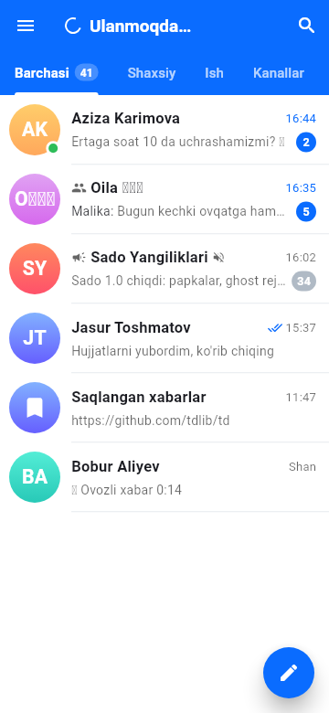
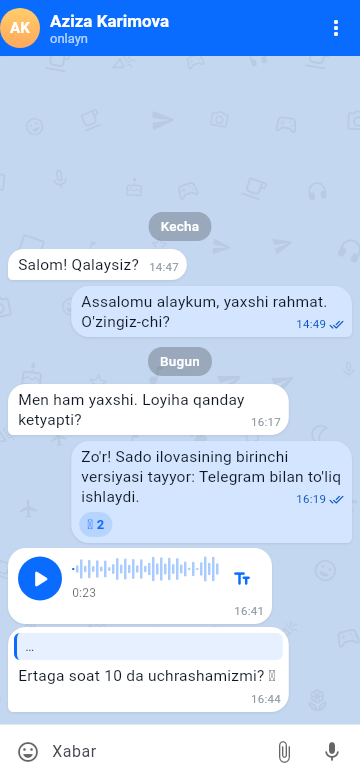
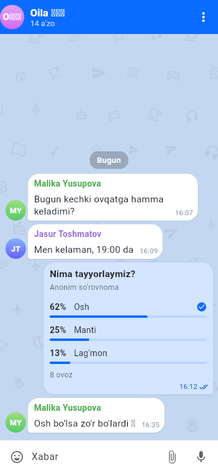
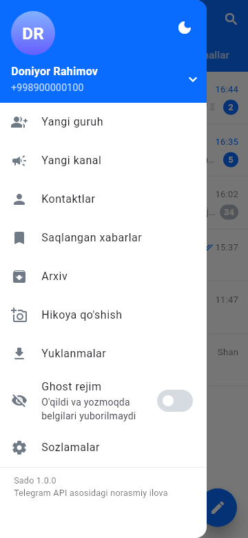
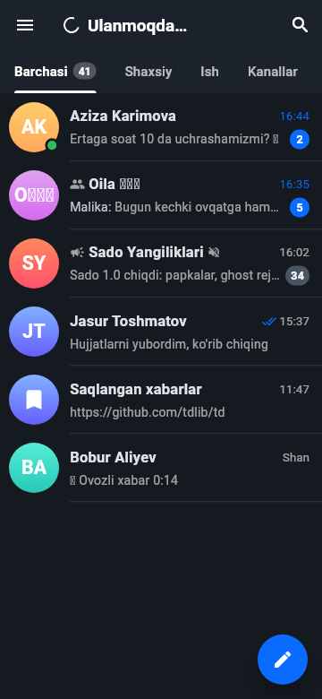
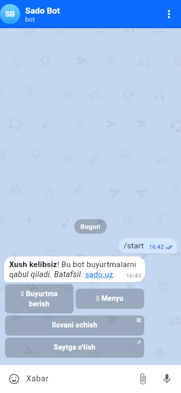
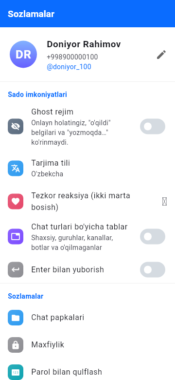
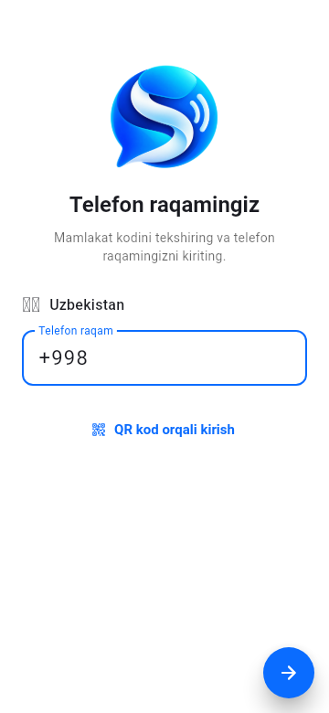
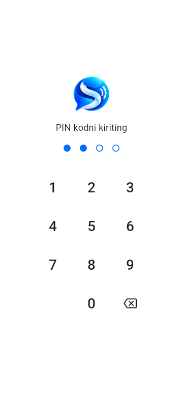
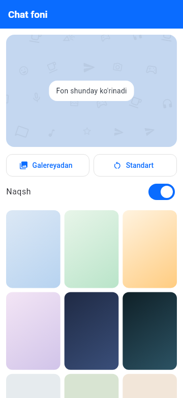

<p align="center"></p>

<h1 align="center">Sado</h1>

<p align="center">Android va iOS uchun Telegram klienti (Flutter + TDLib 1.8.68).<br>
Telegram'ning barcha chatlari, kanallari va guruhlari, ustiga Plus Messenger, Nicegram va iMe uslubidagi qo'shimcha imkoniyatlar.</p>

| Chatlar | Chat | Guruh va so'rovnoma | Menyu | Qorong'i mavzu |
|---|---|---|---|---|
|  |  |  |  |  |

| Bot va tugmalar | Sozlamalar | Kirish | PIN qulf | Chat foni |
|---|---|---|---|---|
|  |  |  |  |  |

## Imkoniyatlar

**Telegram asoslari**
- Telefon raqam bilan kirish: SMS, Telegram ichidagi kod, qo'ng'iroq, Fragment, 2FA parol va uni tiklash, ro'yxatdan o'tish, email tasdiqlash
- QR kod orqali kirish
- Barcha chatlar: shaxsiy chatlar, guruhlar, superguruhlar, kanallar, botlar, maxfiy chatlar (o'qish), "Saqlangan xabarlar"
- Papkalar (Telegram bilan sinxronlanadi): yaratish, tahrirlash, tartiblash, tavsiya etilgan papkalar va har bir papka bo'yicha o'qilmaganlar soni
- Arxiv, chatni qadash, ovozsiz qilish, o'qilgan yoki o'qilmagan deb belgilash, chatni o'chirish yoki tark etish
- Xabarlar: matn (havola, mention, bold, code va spoiler entity'lari bilan), rasm, video, GIF, video-xabar, ovozli xabar (to'lqin shakli va pleyer bilan), audio, fayl, stiker, joylashuv, kontakt, so'rovnoma, qo'ng'iroq yozuvlari va servis xabarlar
- Javob berish, tahrirlash, forward qilish, nusxa olish, havolani nusxalash, pin qilish, bir yoki ikki tomonlama o'chirish, bir nechtasini tanlash, reaksiyalar, ikki marta bosib tezkor reaksiya
- Ovozli xabar yozish (bosib turing; chapga sursangiz bekor bo'ladi), galereya, kamera, fayl, joylashuv, so'rovnoma va kontakt yuborish
- Qoralamalar sinxronlanadi, "yozmoqda…" holati, onlayn holat va "o'qildi" belgilari
- O'qilmagan xabarga, javobga yoki qadalgan xabarga sakrash
- Global qidiruv: chatlar, ochiq kanal va guruhlar, xabarlar
- Profil va chat ma'lumotlari: bio, username, taklif havolasi, a'zolar, umumiy media, fayllar, havolalar, ovozli xabarlar va musiqa
- Guruh yoki kanal yaratish, nomi, tavsifi va rasmini tahrirlash, a'zo qo'shish yoki chiqarish
- Kontaktlar va telefon kontaktlarini sinxronlash
- Sozlamalar: profil, maxfiylik (onlayn holat, raqam, rasm, bio, qo'ng'iroqlar, guruhga taklif), bloklanganlar, faol seanslar (tugatish bilan), bildirishnomalar

- Bot klaviaturalari: inline tugmalar (callback, URL, login, nusxa olish, foydalanuvchi, switch-inline), oddiy reply-klaviatura, telefon raqam yoki joylashuv so'rovi, botni "BOSHLASH"
- Mini App'lar (WebApp): asosiy tugma, orqaga tugmasi, popup, tema, havolalar, botga ma'lumot yuborish
- Telegram Stars bilan to'lov (invoice)
- Forum mavzulari: mavzular ro'yxati, mavzu ichidagi chat, mavzuga yozish
- Hikoyalar (stories): bosh sahifadagi qator, rasm va video ko'rish (ghost rejimda ko'rilganlik yuborilmaydi)
- Animatsion stikerlar: TGS (Lottie) va WebM (Android)
- Ovozsiz yoki rejalashtirib yuborish, rejalashtirilgan xabarlar ro'yxati
- Push-bildirishnomalar (Android, FCM) — Firebase konfiguratsiyasi qo'shilganda yoqiladi
- Matnni formatlash (qalin, kursiv, ustidan chizilgan, spoiler, kod, havola) — matnni belgilab menyudan tanlanadi, tahrirlashda saqlanadi
- `@` mention tavsiyalari va inline botlar (`@gif`, `@vid` va boshqalar)
- Stiker, GIF va emoji paneli: o'rnatilgan to'plamlar, so'nggi va sevimli stikerlar, saqlangan va qidirilgan GIF'lar
- Albomlar: bir nechta rasm/video bitta albom bo'lib yuboriladi va to'r ko'rinishida chiqadi
- Galereyaga saqlash, yuklanmalar menejeri (pauza, davom ettirish, o'chirish)
- Jonli joylashuv (15 daqiqa / 1 soat / 8 soat), to'xtatish tugmasi bilan
- Maxfiy chat boshlash (oxirigacha shifrlangan)
- Guruh/kanal boshqaruvi: adminlar va huquqlar, cheklash va bloklash, umumiy ruxsatlar, sekin rejim, taklif havolalari, qo'shilish so'rovlari, avtomatik o'chirish
- Hikoya joylash, hikoyaga javob va reaksiya
- Sozlamalar: proksi (MTProto, SOCKS5, HTTP, `t.me/proxy` havolasi), ma'lumotlar va xotira (kesh tozalash, saqlash muddati, avtomatik yuklash), ikki bosqichli parolni boshqarish

**Sado qo'shimchalari**
- **Ghost rejim**: onlayn holat, "o'qildi" va "yozmoqda" yuborilmaydi
- **Telegram AI** (TDLib 1.8.68): xabarni tarjima qilish, uzun xabarning qisqacha mazmuni, matndagi xatolarni tuzatish, uslub bilan qayta yozish, emoji qo'shish, ovozli xabarni matnga aylantirish
- **Multi-akkaunt**: 5 tagacha hisob, menyudan bir zumda almashtiriladi
- **Parol bilan qulflash**: 4 xonali PIN, avtomatik qulflash, xato urinishlarda kutish vaqti; qulf yoqilganda bildirishnomalarda matn ko'rsatilmaydi
- **Chat turlari bo'yicha tablar** (Plus Messenger uslubida): shaxsiy, guruhlar, kanallar, botlar, o'qilmagan
- **Yashirin chatlar**: ro'yxatdan yashiriladi, PIN bilan ochiladi, bildirishnomada matn ko'rsatilmaydi
- **Chat foni**: gradientlar, ranglar yoki galereyadan rasm
- **Planshet ko'rinishi**: keng ekranda chatlar ro'yxati va ochiq chat yonma-yon
- Ovozli xabar va video tezligi (1x / 1.5x / 2x)
- Ko'rinish: 7 ta asosiy rang, yorug' yoki qorong'i mavzu, matn hajmi, xabar burchaklari
- 3 til: o'zbek, rus va ingliz
- Enter bilan yuborish, tezkor reaksiyani tanlash, tarjima tilini tanlash

## Tuzilishi

```
mobile/
  lib/core/tdlib/        TDLib JSON FFI: td_create_client_id/td_send/td_receive, alohida isolate'da qabul sikli
  lib/state/telegram.dart  TDLib update'lari asosidagi xotiradagi kesh (chatlar, foydalanuvchilar, fayllar, papkalar)
  lib/state/              Riverpod provayderlari, chat tarixi kontrolleri, amallar (yuborish, AI va h.k.)
  lib/features/           UI: auth, home, chat, profile, contacts, search, settings
  lib/l10n/               uz/ru/en tarjimalari
  tool/build_tdlib_*.sh   TDLib'ni manbadan yig'ish (Android NDK / iOS xcframework)
```

TDLib typed API klasslari [`tdlib_ex`](https://pub.dev/packages/tdlib_ex) 0.44.0 paketidan olinadi (TDLib `c15d3f5a5`, 1.8.68). FFI transport loyihaning o'zida yozilgan.

## Ishga tushirish

### 1. Telegram API kalitlari
[my.telegram.org/apps](https://my.telegram.org/apps) sahifasida `api_id` va `api_hash` oling. Ularni ikki usulda berish mumkin:
- yig'ish paytida: `--dart-define=TG_API_ID=... --dart-define=TG_API_HASH=...`
- yoki ilovaning birinchi ekranida kiritish (qurilmada xavfsiz saqlanadi)

### 2. TDLib native kutubxonasi

```bash
cd mobile
# Android: libtdjson.so → android/app/src/main/jniLibs/{arm64-v8a,armeabi-v7a,x86_64}
ANDROID_SDK_ROOT=$HOME/Android/Sdk tool/build_tdlib_android.sh
# iOS (macOS + Xcode; brew install gperf cmake coreutils): ios/TDLib/tdjson.xcframework
tool/build_tdlib_ios.sh
```

Birinchi yig'ish 1–2 soat oladi; natija `.gitignore` ga kiritilgan.

### 3. Yig'ish

```bash
cd mobile
flutter pub get
flutter run --dart-define=TG_API_ID=12345 --dart-define=TG_API_HASH=0123456789abcdef0123456789abcdef
flutter build apk --release --split-per-abi --dart-define=TG_API_ID=... --dart-define=TG_API_HASH=...
flutter build ipa --dart-define=TG_API_ID=... --dart-define=TG_API_HASH=...
```

Android release imzosi uchun `android/key.properties` faylini yarating (`storeFile`, `storePassword`, `keyAlias`, `keyPassword`).

### CI (GitHub Actions)
`.github/workflows/mobile.yml` quyidagilarni bajaradi:
- `analyze` va `flutter test`, testlar haqiqiy Linux `libtdjson` bilan ishlaydi
- TDLib'ni Android uchun yig'adi va APK'larni artefakt sifatida chiqaradi
- TDLib'ni iOS uchun yig'adi va imzolanmagan IPA chiqaradi

TDLib kesh'lanadi. Repository secrets: `TG_API_ID`, `TG_API_HASH`, ixtiyoriy `ANDROID_KEYSTORE_BASE64`, `ANDROID_KEYSTORE_PASSWORD`, `ANDROID_KEY_ALIAS`, `ANDROID_KEY_PASSWORD`.

## Testlar

```bash
cd mobile
flutter analyze
TDJSON_PATH=/path/to/libtdjson.so flutter test        # FFI, avtorizatsiya oqimi, chat ro'yxati mantig'i
SADO_SCREENSHOTS=1 TDJSON_PATH=... flutter test test/screenshots_test.dart --update-goldens
```

## Monetizatsiya (billing server)

`server/` — Sado Pro, AI Writer, Business va tema/ikonka paketlari uchun server tomonidagi xaridni
tekshirish va huquqlar (entitlements) xizmati. Telegram ma'lumotlari, sessiyalari va xabarlari serverga
yuborilmaydi. Hozircha 1-bosqich (asos) tayyor, to'lovlar o'chirilgan
(`SADO_BILLING_PAYMENTS_ENABLED=false`). Batafsil: [docs/monetization](docs/monetization/README.md).

```bash
cd server && python3.13 -m venv .venv && .venv/bin/pip install -r requirements-dev.txt
.venv/bin/pytest -q
```

## Push-bildirishnomalar (Android)

1. Firebase'da Android ilova yarating (`uz.sado.app`) va `google-services.json` ni `mobile/android/app/` ga qo'ying.
2. Telegram push'larni sizning `api_id` uchun yetkazishi kerak. Buning uchun Telegram tomonida FCM sozlamasi talab qilinishi mumkin: [core.telegram.org/api/push-updates](https://core.telegram.org/api/push-updates) sahifasini tekshiring.
3. Fayl bo'lmasa ilova odatdagidek ishlaydi, push o'chiq qoladi. Ilova ochiq yoki fonda bo'lganda lokal bildirishnomalar har doim ishlaydi.

## Crash hisobotlari (ixtiyoriy)

`--dart-define=SENTRY_DSN=https://...` bilan yig'ilganda xatolar Sentry'ga yuboriladi. Hisobotda foydalanuvchi, xabar matni, skrinshot va breadcrumb bo'lmaydi; tokenlar, `api_hash` va telefon raqamlari o'chiriladi. DSN berilmasa hech narsa yuborilmaydi.

## Hozircha yo'q

- **Ovozli va video qo'ng'iroqlar, guruh video chatlari**: Telegram qo'ng'iroqlari `tgcalls` (WebRTC) native kutubxonasini Android NDK va iOS uchun yig'ib, Dart bilan bog'lashni talab qiladi. Qo'ng'iroq yozuvlari ko'rsatiladi.
- **iOS push**: Notification Service Extension kerak; hozir iOS'da faqat ilova ochiq yoki fonda turganda bildirishnoma keladi.
- Karta orqali to'lov (Stars ishlaydi), custom emoji, iOS'da WebM stikerlar (eskiz ko'rsatiladi), rasm/video muharriri.
